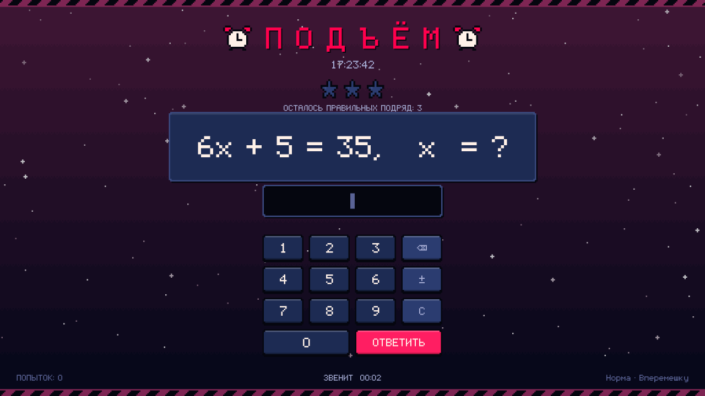
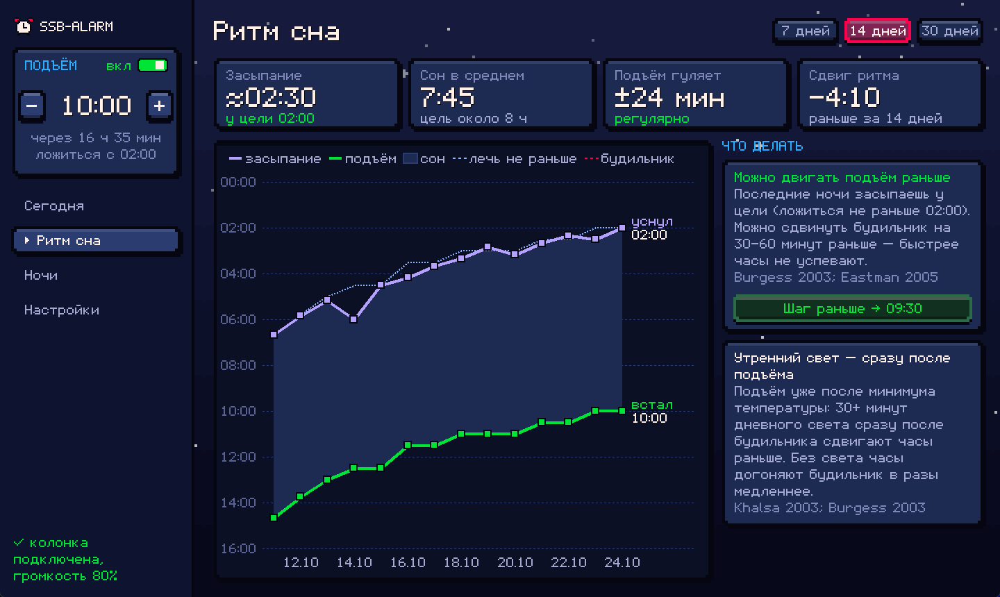
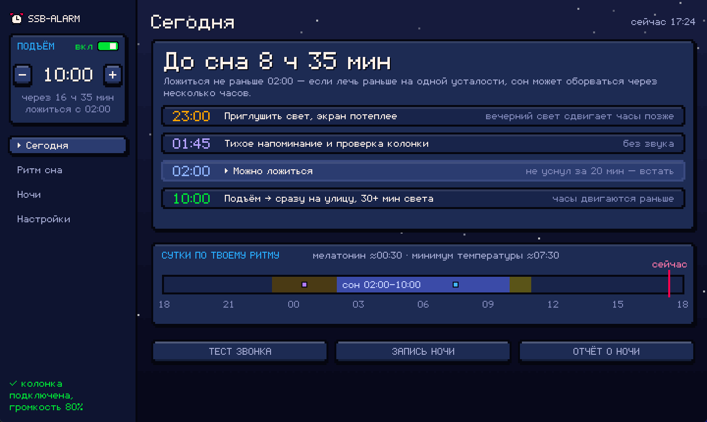

# Самый сложный будильник

**Русский** | [English](README.en.md)

**Вы ставите пять будильников и всё равно встаёте в два часа дня? Выключаете звонок, не просыпаясь, и потом не помните, как это было? Засыпаете в пять утра, спите по десять часов и встаёте разбитым? Вот и у меня так было.**

Обычный будильник с таким не справляется: его выключаешь сонным за секунду. Поэтому этот будильник замолкает только после нескольких правильных ответов подряд, а через 10 минут проверяет, не уснул ли ты обратно. Но одним звонком режим не вернуть, поэтому он ещё ведёт дневник сна, оценивает твой циркадный ритм и подсказывает, когда двигать подъём раньше, а когда пока держать.

Всё построено на исследованиях сна: от частоты звонка до шага, с которым двигать подъём. Где доказательства слабые, так и написано.

Софт написан на Claude: столько исследований и переделок ради одного будильника мог осилить либо сумасшедший человек, либо миллионы токенов нейросети.

Будильник для Windows, построенный на исследованиях сна.

<p align="center">
  <a href="https://github.com/proradian/ssb-alarm/releases/latest/download/ssb-alarm.zip"></a>
  <br>
  <sub>Windows 10 и 11 · нужен <a href="https://www.python.org/downloads/">Python 3</a> · архив 65 КБ · <a href="https://github.com/proradian/ssb-alarm/releases">все версии</a> · <a href="#безопасность">безопасность</a></sub>
</p>

<p align="center">
  
</p>

<p align="center">
  
  &nbsp;
  
</p>

## На чём построен ssb-alarm

1. **Звонок, который будит.**
   - [Bruck & Thomas](https://vuir.vu.edu.au/6587/): низкий меандр 520 Гц при 75 дБА будил 92% взрослых со сниженным слухом против 56% у привычного высокого писка; в других группах низкий тон тоже выигрывал. Поэтому звонок построен на ~520 Гц.
   - [McFarlane et al. 2020](https://www.rmit.edu.au/news/all-news/2020/feb/melodic-alarms): мелодичные будильники связаны с меньшей утренней разбитостью (опрос 50 человек). [KTH, 18 человек](https://dael.euracoustics.org/confs/fa2026/data/articles/000156.pdf): плавно нарастающий звонок улучшал настроение. Поэтому это мелодия, которая за 4 минуты нарастает от тихой до полной громкости, а после 8 минут становится резкой.
   - Звук идёт прямо в выбранную колонку, не трогая устройство по умолчанию. Перед звонком громкость колонки поднимается и выключение звука снимается, после звонка всё возвращается как было.

2. **Задачи подряд и проверка через 10 минут.**
   - [Hilditch & McHill 2019](https://www.dovepress.com/sleep-inertia-current-insights-peer-reviewed-fulltext-article-NSS): сонная инерция длится 15–30 минут и дольше, а хуже всего после недосыпа и у поздних хронотипов. Главный провал — выключить звонок и уснуть снова.
   - Поэтому звонок гасится только несколькими правильными ответами подряд: математика и логика, три уровня сложности. Ошибка обнуляет серию.
   - Через 10 минут после решения появляется ещё одна задача с мягким звуком. Не ответил за 2 минуты — звонок начинается заново.
   - Проснулся раньше будильника — «Я встал.bat» (или `ssb_alarm.py --up`): 10 задач, и звонок заменится тихой проверкой. Работает только за 2 часа до подъёма, чтобы им нельзя было выключить будильник с вечера.

3. **Подъём в одно время каждый день.**
   - [Windred et al. 2024](https://www.ncbi.nlm.nih.gov/pmc/articles/PMC10782501/), UK Biobank, 60 977 человек: регулярность сна предсказывала смертность сильнее, чем его длительность.
   - [Европейское руководство по бессоннице 2023](https://pure.uva.nl/ws/files/260029353/Journal_of_Sleep_Research_-_2023_-_Riemann_-_The_European_Insomnia_Guideline.pdf): когнитивно-поведенческая терапия бессонницы — первая линия лечения, и подъём в одно время при любой ночи — её основа.

4. **«Ложиться не раньше» и правило 20 минут.**
   - [Maurer et al. 2021](https://em-consulte.com/article/1459830/the-clinical-effects-of-sleep-restriction-therapy-) и [сетевой метаанализ 2024](https://pubmed.ncbi.nlm.nih.gov/39504928/), 80 исследований: ограничение времени в кровати и правило «не уснул — встань» — самые действенные части терапии бессонницы.
   - [Borbély et al. 2016](https://doi.org/10.1111/jsr.12371): сон держат вместе усталость и внутренние часы. Из модели следует: если лечь рано на одной усталости, пока часы ещё «днём», сон может оборваться после первых циклов — это наше толкование модели, а не измеренная закономерность. Поэтому у программы практическое правило «ложиться не раньше подъёма минус 8 часов»; в терапии бессонницы окно сна подбирают индивидуально.
   - Напоминание приходит **без звука**: звук разбудил бы того, кто уже уснул. Заодно оно проверяет, подключена ли колонка, пока ты ещё не спишь.

5. **Сдвиг режима по 30–60 минут, а не рывком.**
   - [Burgess et al. 2003](https://pubmed.ncbi.nlm.nih.gov/12932084/): при сдвиге сна на час в день часы за три дня догнали на 0,6 часа при обычном свете и на 2,1 — при ярком утреннем. [Eastman et al. 2005](https://pmc.ncbi.nlm.nih.gov/articles/PMC1249488/): в их протоколе сдвиг на 2 часа в день не дал преимущества перед часом.
   - [Wilhelmsen-Langeland, Saxvig et al.](https://bora.uib.no/handle/1956/7648), Берген: у молодых людей с поздним ритмом режим сдвинулся во всех группах, даже с тусклым светом и плацебо, — всем постепенно двигали подъём. [РКИ 2022](https://pubmed.ncbi.nlm.nih.gov/36181304/): мелатонин и свет без сдвига подъёма часы сдвинули, а время сна — нет.
   - Поэтому есть лестница: время подъёма по датам и кнопка «Шаг раньше −30 минут». Всё расписание само встаёт в Планировщик задач.
   - [AASM 2015](https://pmc.ncbi.nlm.nih.gov/articles/PMC4582061/): по хронотерапии («крутить режим вперёд») руководство рекомендации не даёт — доказательств недостаточно. Будильник её не предлагает.

6. **Свет утром и тусклый вечер.**
   - [Khalsa et al. 2003](https://pubmed.ncbi.nlm.nih.gov/12717008/): свет до минимума температуры тела сдвигает часы позже, после — раньше. Поэтому совет зависит от того, звонит будильник до минимума или после: «сразу на улицу» или «на улицу после 07:45».
   - [Tzischinsky & Lavie 1997](https://journals.sagepub.com/doi/reader/10.1177/074873049701200307): яркий вечер сдвигает ворота сна позже. Поэтому за 2–3 часа до сна — совет приглушить свет.
   - [Stothard et al. 2017](https://www.colorado.edu/lab/sleepdev/content/stothard-2017): выходные на природе без вечернего электричества сдвинули часы раньше — около 70% эффекта целой недели.

7. **График ритма и честная оценка.**
   - [Burgess et al. 2003](https://katalog.lib.cas.cz/KNAV/EdsRecord/edb,11698861) и [Sletten et al. 2010](https://www.frontiersin.org/journals/neurology/articles/10.3389/fneur.2010.00137/pdf): вечерний мелатонин начинается в среднем за 2 часа до привычного засыпания. [Burgess & Eastman](https://stacks.cdc.gov/view/cdc/189902/cdc_189902_DS1.pdf): минимум температуры — примерно через 7 часов после него.
   - Будильник берёт медиану засыпания за 5 ночей, чтобы одна плохая ночь не сбивала оценку. На графике две линии — засыпание и подъём — и пунктир цели: видно, как режим ползёт к цели.
   - Разброс между людьми — до нескольких часов. Это оценка по поведению, а не анализ: точно мелатонин меряют в слюне в лаборатории сна.

8. **Дневник без возни.**
   - Время подъёма будильник знает сам — это момент, когда решены задачи. После звонка он задаёт **один вопрос**: во сколько ты примерно уснул. Кнопка «Иду спать» в напоминании записывает, когда лёг, и подставляет ответ.

9. **Цель — около 8 часов, а не «чем больше, тем лучше».**
   - [AASM и SRS 2015](https://pmc.ncbi.nlm.nih.gov/articles/PMC4442216/): взрослым — 7 часов и больше. [Wild et al. 2018](https://pmc.ncbi.nlm.nih.gov/articles/PMC6289236) и [Li, Sahakian & Feng 2022](https://www.doi.org/10.1038/s43587-022-00210-2): мышление лучше всего около 7 часов и хуже и при меньшем, и при большем сне.
   - [NHANES 2024](https://www.frontiersin.org/journals/medicine/articles/10.3389/fmed.2024.1461785/full): меньше всего хронической боли около 7 часов. [Grandner & Drummond 2007](https://em-consulte.com/article/393575/who-are-the-long-sleepers-towards-an-understanding): долгий сон чаще сигнал проблемы (апноэ, настроение), чем её причина. Всё это связи, не доказанные причины, — поэтому будильник не учит «спать поменьше», а при долгом сне советует врача.

10. **Запись ночи — не диагноз.**
    - [SleepCheck](https://www.mobihealthnews.com/news/preliminary-data-resapps-new-platform-detects-sleep-apnea-86-sensitivity): один проверенный акустический алгоритм — 86% чувствительности и 83% специфичности для апноэ средней тяжести (AHI ≥ 15), и то в своих условиях. Запись ночи в ssb-alarm проще: громкость и паузы в дыхании. Это повод решить, идти ли к сомнологу, а не диагноз.

Подробности, оговорки и пометки, что сверено по полному тексту, а что по аннотации, — в [списке исследований](docs/research/SOURCES.md) и отчёте [«Сон, режим и будильник»](docs/research/reports/Сон,%20режим%20и%20будильник.md).

## Безопасность

- **Код открыт.** Вся программа — один файл [`ssb_alarm.py`](ssb_alarm.py) на стандартной библиотеке Python, без сторонних пакетов. Его можно прочитать целиком.
- **Файл не подменён.** Контрольная сумма SHA-256 архива `ssb-alarm.zip` версии 1.0.0:
  `a47cc2330ffab00db034a504cbbe96134551693aaf8f6865255ce302c9f685bf`
  Проверить в PowerShell: `Get-FileHash .\ssb-alarm.zip` — значения должны совпасть.
- **Что программа делает на компьютере.**
  - Создаёт задачи Планировщика Windows «Будильник» и «Будильник-отбой» (и «Будильник-свет», если настроить свет). Задача будильника может разбудить спящий компьютер.
  - Перед звонком поднимает громкость выбранной колонки и снимает выключение звука, после звонка возвращает как было.
  - Микрофон включается только в режиме «Запись ночи». Сам звук ночи удаляется, остаются отчёт и короткие фрагменты пауз.
  - В сеть ходит только к API умного дома Яндекса, и только если вы сами настроили рассвет. Больше никуда.

## Установка

1. Установите [Python 3](https://www.python.org/downloads/) и при установке отметьте **Add python.exe to PATH**.
2. Скачайте и распакуйте [архив](https://github.com/proradian/ssb-alarm/releases/latest/download/ssb-alarm.zip).
3. Запустите **«Запустить будильник.bat»**. Откроется панель: выставьте время кнопками − и + и включите переключатель.
4. Нажмите **«Тест звонка»** и решите одну задачу — так вы услышите звонок и убедитесь, что звук идёт куда нужно.

Аварийно погасить звонок: `taskkill /IM pythonw.exe /F`.

| Команда | Что делает |
|---|---|
| `pythonw ssb_alarm.py` | главное окно: будильник слева, страницы «Сегодня», «Ритм сна», «Ночи» |
| `pythonw ssb_alarm.py --settings` | только настройки звонка: сложность, задачи, звук |
| `pythonw ssb_alarm.py --now` | звонок сейчас (так его запускает Планировщик) |
| `pythonw ssb_alarm.py --up` | «Я встал»: проснулся раньше — 10 задач |
| `pythonw ssb_alarm.py --bedtime` | тихое напоминание об отбое |
| `pythonw ssb_alarm.py --record` | записать ночь с микрофона |
| `python ssb_alarm.py --check` | подключена ли колонка и какая громкость |
| `python ssb_alarm.py --devices` | список устройств вывода звука |

### Bluetooth-колонка: беззвучный будильник — реальный риск

Если Windows разрешено усыплять Bluetooth-адаптер, система «играет» звук в колонку, а из неё ничего не слышно. В журнале при этом ошибка BTHUSB 3: «адаптер не ответил». Мы на это наткнулись. Перед тем как доверять колонке:

1. Диспетчер устройств → Bluetooth → ваш адаптер → «Управление электропитанием» → снимите **«Разрешить отключение этого устройства для экономии энергии»**.
2. Выключите временную приостановку USB (терминал от имени администратора):
   ```powershell
   powercfg /SETACVALUEINDEX SCHEME_CURRENT 2a737441-1930-4402-8d77-b2bebba308a3 48e6b7a6-50f5-4782-a5d4-53bb8f07e226 0
   powercfg /SETACTIVE SCHEME_CURRENT
   ```
3. Вставьте адаптер в порт USB 2.0 или на удлинитель, подальше от донглов 2,4 ГГц.
4. Держите запасной будильник на телефоне или на самой колонке.

## Структура

| Путь | Что это |
|---|---|
| `ssb_alarm.py` | Весь будильник: окно звонка, главное окно, дневник, оценка ритма, Планировщик, звук |
| `Запустить будильник.bat` | Запуск главного окна двойным щелчком |
| `Я встал.bat` | «Я встал»: проснулся раньше будильника — 10 задач вместо звонка |
| `docs/research/` | Исследования, на которых построен будильник |
| `docs/screenshots/` | Скриншоты для README |
| `tests/` | Тесты: расписание, оценка ритма, падение Tcl, разбор записи ночи, свет |
| `tools/` | Скриншоты для README и сборка архива релиза |

## Данные

Всё хранится только на вашем компьютере, в папке программы: `settings.json` (настройки), `diary.csv` (ночи), `alarm.log` (журнал звонков), `records/` (отчёты о ночах). ssb-alarm ничего никуда не отправляет.

## Тесты

```powershell
cd tests
foreach ($t in Get-ChildItem test_*.py) { python -X utf8 $t }
```

## Важно

Это **не медицинский прибор**. Оценка ритма — расчёт по поведению, запись ночи — не диагноз. Очень долгий сон, громкий храп, остановки дыхания, сонливость днём — повод сходить к сомнологу. Если засыпание стабильно в 3–6 утра, возможен синдром задержки фазы сна: его лечит врач, и мелатонин в рассчитанное время — единственное средство с рекомендацией AASM.

## Лицензия

[MIT](LICENSE)

## Промпт: свой будильник

Скопируйте этот запрос в ChatGPT, Claude или другую нейросеть. Получится один файл на Python, весь код которого можно прочитать. С первого раза он будет проще ssb-alarm, доводить придётся несколькими уточнениями.

```text
Напиши будильник для Windows одним файлом на Python, только стандартная библиотека (tkinter, ctypes, subprocess). Интерфейс на русском, код понятный, с короткими комментариями.

ЗВОНОК
- Окно на весь экран поверх всех окон, его нельзя закрыть Alt+F4 и Esc.
- Замолкает только после N правильных ответов ПОДРЯД (по умолчанию 3). Задачи: устный счёт и логика (что лишнее, продолжи ряд, дни недели) с 4 вариантами. Ошибка обнуляет серию и даёт паузу 3 секунды.
- Звук: мелодия на основе меандра около 520 Гц (низкий тон будит лучше высокого писка), громкость нарастает от 12% до 100% за 4 минуты, после 8 минут — резкий плотный ритм. Звук генерируй сам в WAV, без файлов.
- Через 10 минут после решения — ещё одна задача с мягким звуком; нет ответа за 2 минуты — звонок заново, до 6 раз.

РАСПИСАНИЕ
- Звонок запускает Планировщик задач Windows (PowerShell Register-ScheduledTask) с WakeToRun, без ограничения времени работы.
- Время подъёма можно задать по датам (лестница сдвига режима), шаг раньше — кнопкой на 30 минут.
- Тихое напоминание без звука за 15 минут до «ложиться не раньше» (подъём − 8 ч): «пора спать», а раньше этого времени — «рано, даже если клонит».

ДНЕВНИК И РИТМ
- После звонка один вопрос: «Во сколько примерно уснул?» (кнопки ±15 минут и ±1 час). Подъём = момент решения задач. Сохраняй в CSV.
- График за 7/14/30 дней: две линии — засыпание и подъём, между ними закрашен сон, пунктиром цель.
- Оценка ритма: медиана засыпания за 5 ночей; мелатонин ≈ засыпание − 2 ч; минимум температуры ≈ мелатонин + 7 ч. Советы: свет сразу после подъёма, если подъём позже минимума температуры, иначе — после минимума; тусклый свет за 3 ч до сна; если 3 ночи засыпание у цели — можно двигать подъём на 30 минут раньше, если позже цели больше чем на час — держать.

ЧЕГО НЕ ДЕЛАТЬ
- Не обещай «будильник по фазе сна» и циклы по 90 минут: без датчиков фазу не узнать.
- Не пиши, что 9+ часов сна — норма для всех, и не советуй «спать поменьше». Долгий сон — повод к врачу.
- Не выдавай оценку ритма за измерение и разбор звука ночи за диагноз.
```
